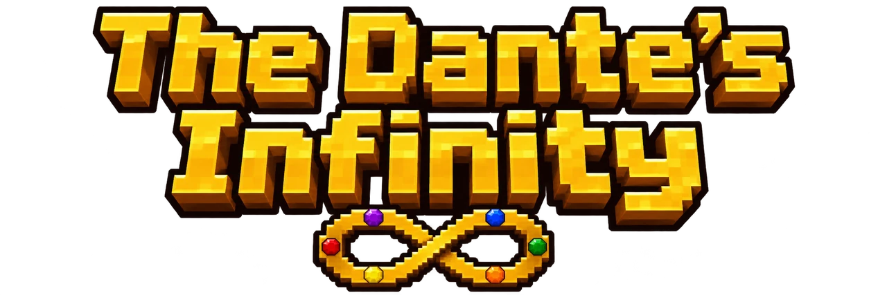

<p align="center">
  
</p>

# The Dante’s Infinity (Fabric, Minecraft 26.1.2)

[🇬🇧 English](README.md) · 🇷🇺 Русский

В сборку входит аддон **[The Fury of Doom](#the-fury-of-doom--латверия-и-доктор-дум)**: Латверия, замок Дума, Думботы и сам Доктор Дум.

Требования: **Java 25**. Сборка: `./gradlew build` → `build/libs/infinity_gauntlet-1.0.7.jar` (+ Fabric API 0.155.3+26.1.2).

```
./gradlew runClient          # тестовый клиент
./gradlew runClientGameTest  # визуальный прогон со скриншотами (build/run/clientGameTest/screenshots)
./gradlew runClientGameTest -PonlyTest=SoulQuestTest  # только один тест (Linux без экрана: xvfb-run -a)
```

## Начало игры

- **Уру** встречается в новых чанках Верхнего мира от дна мира до Y=0. Ищи около Y=−32, добывай алмазной или незеритовой киркой. Сырую Уру переплавляй в печи или плавильне. Удача увеличивает дроп, Шёлковое касание сохраняет блок руды.
- **Перчатка** крафтится на верстаке 3×3. Ряды сверху вниз: Уру / золото / алмаз, золото / редстоун / золото, алмаз / золото / Уру. Уру и золото нужны в слитках. В мире (в сундуках деревень, кузниц, крепостей, данжей, шахт, храмов, пирамид, кораблей, руин, особняков, древних городов, бастионов, адских крепостей и городов Энда, а также у картографов, кузнецов, библиотекарей и странствующих торговцев) встречается **Схема Перчатки Бесконечности** с наглядной раскладкой рецепта; ПКМ по схеме открывает рецепты Перчатки, брони и переплавки Уру. ПКМ с перчаткой в основной руке открывает слоты, F переносит её во вторую руку.
- **Броня Уру** крафтится как железная и ремонтируется слитками Уру. Полный комплект снижает урон полной перчатки и теряет прочность при поглощении удара.
- Все шесть Камней Бесконечности имеют собственные способы добычи в выживании, описанные ниже. Игровой путеводитель обновляется при открытии. Получить экземпляр можно командой `/gauntlet_guide`.

## Гром-Секира
- Для ковки нужны пять слитков Уру, звезда Незера и бревно тропического дерева. Ряды рецепта сверху вниз — **Уру / Уру / звезда Незера**, **Уру / Уру / Уру**, **пусто / бревно / пусто**. Секира закрепляется за игроком сразу при ковке.
- Во время грозы в Верхнем мире Гром-Секира может упасть с неба недалеко от игрока. В радиусе 110 блоков появляется голубой компас с расстоянием до места падения. Он исчезает, когда кто-то вытаскивает секиру ПКМ и становится владельцем. На мир приходится одна секира, поэтому первая ковка исключает падение, а первое падение закрывает рецепт. Ковать секиру можно на верстаке.
- Возьми её в основную руку. **ЛКМ** — три рубящих удара сверху. Зажми **ЛКМ**, глядя на землю, и отпусти для удара широкой стеной молний и обломков поперёк направления атаки. Волна сносит разрушаемые блоки и оставляет цепочку кратеров, если сервер разрешает менять мир способностями. **ПКМ** — удар молниями в радиусе 7 блоков. **X** — горизонтальный бросок, **H** — Ярость небес в радиусе 20 блоков, **J** — полёт. **Q** втыкает секиру в землю и сохраняет владельца, **K** призывает её из любого измерения или из бездны. Клавиши можно переназначить в настройках управления.
- Секира пробивает разрушаемые блоки там, где разрешено менять мир. При смене измерения или непроходимой преграде она возвращается к владельцу. Если инвентарь полон, возврат дождётся свободной ячейки. В секиру, воткнутую в землю, периодически бьют молнии. В Верхнем мире они тянутся от облаков. После смерти её можно поднять на месте ПКМ или призвать клавишей K.
- Секира в руке даёт силу и снижает прямой урон Перчатки, включая взрывы метеоритов. Она защищает от контроля Разума и Души, чужого Щелчка и переноса при разрушении планеты. Удар и Изнанка Реальности всё ещё могут убить владельца.

## Как добыть Камень Силы
- Иногда (первый раз через ~20 мин, потом раз в 20–50 мин игрового времени) в 60–110 блоках от игрока в Верхнем мире проходит **метеоритный дождь**; игроки рядом получают сообщение в HUD и чат с направлением.
- Последний метеорит — **фиолетовый**: остаётся фиолетовый метеорит (алмазная кирка), в ядре — **Сфера**. Метеорит, который игрок проигнорировал, **теряет Сферу, когда начинается следующий дождь** (камень не может задублироваться). Во время дождя небо и солнце краснеют. Когда Сферу забрали, дожди больше не идут; ПКМ открывает её, Камень Силы падает в рюкзак. Вторая Сфера откроется пустой.
- Голый Камень Силы в любой руке **убивает за 2 с** (в креативе — нет). В перчатке и рюкзаке он безопасен.
- Камни (отдельные, в перчатке или извлекателе, запечатанная Сфера) при смерти остаются у игрока и возвращаются после возрождения — **если только не убил другой игрок**. Выброшенный камень не исчезает и не уничтожается.
- Настройки: `powerShower*`, `powerStoneHoldTicks`. Команды оператора: `/gauntlet power_shower`, `/gauntlet stones`, `/gauntlet stones reset`. Тест: `xvfb-run -a ./gradlew runClientGameTest -PonlyTest=PowerStoneTest`.

## Как добыть Камень Пространства
- После убийства **Дракона Края** на острове Края открывается большой ледяной разлом (`/gauntlet space_quest rift` — открыть принудительно). Он ведёт на небольшой **ледяной астероид** далеко за пределами галактики (отдельное измерение, строится при первом визите).
- Там смертельный холод: без **полного комплекта железной брони или лучше** (тег `infinity_gauntlet:cold_protection`: железо, алмаз, незерит, Уру) игрок замерзает. Креатив не страдает.
- Камень лежит на вершине огромной древней ледяной башни **внутри Тессеракта** (синий куб). Подняв его, видишь *«Используй куб, чтобы попасть домой»*; ПКМ отправляет на Землю. Обратно ведёт и разлом на астероиде.
- **Брось Тессеракт в лаву**: он взорвётся, лава вокруг станет обсидианом, появится сияющий Камень Пространства (один раз за мир; второй куб расколется пустым).
- Арт: пак `01_Space_Quest`. Тест: `xvfb-run -a ./gradlew runClientGameTest -PonlyTest=SpaceQuestTest`.

## Как добыть Камень Реальности
- В Незере раз в минуту проходит одна проверка шанса на группу соседних игроков (`realityFogChancePerMinute`). На сервере одновременно появляется один **красный туман** с одним камнем. Камень получает первый игрок, попавший по нему в ближнем бою или любым снарядом.
- Арт: пак `02_Reality_Quest` (слои карты плотности тумана, след камня, попадание стрелы, рассеивание). Отладка: `/gauntlet reality_fog`. Смоук: `-PonlyTest=RealityFogTest`.

## Как добыть Камень Души
- В каждом мире есть **Храм Души** (1000-1600 блоков от спавна): одинокая снежная гора посреди плоской снежной пустоши, к вершине вьётся лестница с заборами и руинами, наверху — разрушенный храм с пропастью. Рельеф перестраивается по мере загрузки чанков. Карты (**Карта Храма Души**, ПКМ — развернуть в настоящую карту с крестиком) лежат в сундуках иглу, кораблей (карты), библиотек крепостей, картографов, данжей и шахт; их продают картографы и странствующие торговцы.
- **Сбрось в туманную пропасть приручённое животное** или столкни другого игрока ударом у края. При жертве животного ритуал засчитывается хозяину, при жертве игрока — тому, чей удар засчитался последним у края. Прыжок без жертвы ритуал не запускает. После начала ритуала небо станет янтарным, луч ударит в облака, всё потемнеет, и участник ритуала очнётся в **мире души** (тёмное мелководье, красное солнце). Из воды поднимется Камень Души; подобрав его, увидишь *«Используй Камень Души, чтобы вернуться в храм»*, ПКМ вернёт на вершину. Один раз за мир; если уйти, не взяв камень, квест сбрасывается.
- Арт: пак `05_Soul_Quest`. Отладка: `/gauntlet soul_quest temple_here | locate | map | ritual`. Смоук: `-PonlyTest=SoulQuestTest`.

## Как добыть Камень Времени
- В деревнях, у картографов и странствующих торговцев, в сундуках руин, храмов, данжей и шахт можно найти **Карту Храма Времени** (ПКМ — развернуть). Она ведёт к единственному на мир **Храму Времени** с часовой башней.
- Внутри храма стоит сломанный **механизм часов**. Чтобы запустить его, нужно собрать и вставить (ПКМ) **три великие шестерни из разных измерений**: **Древнюю Шестерню Верхнего Мира**, **Древнюю Шестерню Незера** и **Древнюю Шестерню Энда**. Они выпадают с мобов в соответствующем измерении и лежат в сундуках крепостей, данжей, бастионов и городов Энда.
- После установки всех трёх шестерён часы запускаются и выдают игроку **Камень Времени**. Отладка: `/gauntlet time_quest temple_here | locate | map | gears`. Смоук: `-PonlyTest=TimeQuestTest`.

## Как добыть Камень Разума
- В деревнях, у картографов и странствующих торговцев, в сундуках руин, храмов, данжей и шахт можно найти **Карту разрушенного города** (ПКМ — развернуть). Она ведёт к единственному на мир **Разрушенному городу**.
- При входе в город поднимается барьер и появляются **10 зомби Разума**. Арену нельзя покинуть телепортом, перелететь или раскопать. Урон от окружения не засчитывается. После смерти игрок возрождается за барьером. Если погиб весь отряд, бой начинается заново при входе. После прохождения волны зомби повторная попытка сразу начинается с портала Локи.
- Убийства зомби способностями камней идут в зачёт. Пока Камень Разума не получен, Танос держится подальше от города, даже если у тебя уже есть остальные пять камней. Разрушение планеты блокируется во время боя с Локи.
- После **десятого зомби Разума** город заливает золотой свет, и из портала выходит **Локи**. Он использует защитные руны, кинжалы, дальние заклинания и сбивает полёт Гром-Секиры и Перчатки. В первой фазе он периодически телепортируется на руины, обстреливает отмеченные области и возвращается в ближний бой. Иллюзии разбиваются одним ударом. На 45% здоровья бой прерывает общая сцена превращения в **Фенрира**. Волк кусает, бьёт лапой и оглушает рёвом. Полоска здоровья меняется вместе с обликом.
- **Стрелы, взрывы и атаки Камней Бесконечности** особенно эффективны. Побеждённый Фенрир вновь принимает облик Локи. Локи опускается на колени и рассыпается искрами. Затем перед ближайшим участником формируется **Камень Разума**. Он летит к игроку и попадает в инвентарь, после чего барьер открывается. На месте боя выпадает **650 опыта**.
- Достижения: **«Хорошая попытка, Локи»** за разбитую иллюзию и **«Бог коварства»** за победу над Локи. Отладка: `/gauntlet mind_quest city_here | locate | map | summon`. Тест: `-PonlyTest=MindQuestTest`.

## Финальный босс: Танос
- Собери **5 разных камней** (россыпью, в перчатке или извлекателе, в запечатанной Сфере или Тессеракте) — и Безумный Титан придёт за тобой из глубин космоса. Он приходит только после **передышки в полсуток** (12000 тиков, `thanosDelayTicks`) с момента, как у игрока набрались камни; за ~10 с до появления приходит предупреждение.
- **Верхний мир:** в небо плавно входит его корабль «Санктуарий II», небо приобретает опасный красноватый оттенок, солнце краснеет; синий луч опускает Таноса в десятке блоков от игрока. **Незер** (или глубоко под землёй): в реальности открывается разлом, и Танос выходит из трещины. **Энд:** прилетает корабль, Энд слегка освещается; живого дракона корабль сначала уничтожает выстрелом.
- Танос произносит реплику на английском («I came to pick up mine»; «Give me the stones!», если своей перчатки у игрока нет), появляется полоса босса **«Танос – Безумный Титан»**, начинается музыка и бой.
- Он рубит двойным мечом, отбрасывает ударом перчатки, высоко прыгает и бьёт о землю, бросает меч бумерангом. На половине здоровья впадает в ярость, наносит на 35% больше урона и получает на 40% меньше. Он чередует расходящуюся по земле ударную волну и три взрыва по отмеченным точкам. Оранжевые кольца предупреждают об ударах. Поднятый щит останавливает взмах меча, но выбивается из рук.
- Его удары почти не замечают обычную броню: **без полного комплекта Уру победить его практически невозможно** (Уру пропускает лишь 30%). Больше всего он боится **перчатки**: любая способность надетой перчатки бьёт его сильно (×1.4; со всеми шестью камнями ×2.2), а **Луч Бесконечности** при полном попадании может снять до ~45% здоровья до учёта защиты в ярости. Дальше идут **камни без перчатки** (×0.7) и **взрывы** (×0.7); **незеритовый и алмазный мечи** почти не ранят его (×0.4 / ×0.3). Обычное оружие ограничено уроном за удар, поэтому Острота, Сила, криты, булава и TNT его не сносят. Атаки Гром-Секиры наносят полный базовый урон до фазы ярости. Большинство остальных видов оружия его почти не царапают. Настройки: `thanosGauntletMult`, `thanosFullGauntletMult`, `thanosBeamShare`, `thanosLooseStoneMult`, `thanosNetheriteSwordMult`, `thanosDiamondSwordMult`. Он спокойно идёт через воду и не застревает.
- Поражение: Танос падает на колено, говорит последние слова и **рассыпается в пыль**. Остаётся его **пустая Перчатка Бесконечности** (если игрок ещё не сделал свою; иначе Танос приходит без неё) и много опыта. Больше он не возвращается (`/gauntlet thanos start | now | spawn` не вызовут побеждённого Таноса до `/gauntlet thanos reset`).
- **Корабль падает.** Оставшись без хозяина, «Санктуарий II» теряет управление: клонится носом вниз, горит и разваливается в воздухе, затем врезается в землю примерно в 60 блоках. Ударная волна, обугленный кратер с грудой обломков, пожар вокруг и дождь из **железа и незерита** (слитки, обломки, несколько незеритовых слитков, железные блоки; в огне не сгорают). После падения корабль **строится из настоящих блоков** (~40 тыс.: чёрный камень, железные блоки, глубинносланцевая плитка, лампы; внутри полый, на нём дымят костры) и **остаётся в мире навсегда**, в том измерении, где упал. Отключить: `thanosShipCrash`, `thanosShipCrater`, `thanosShipWreck`.
- Если игрок погиб, убежал дальше ~100 блоков или вышел из игры, Танос отступает (музыка плавно стихает) и возвращается через `thanosReturnMinutes` (5) минут.
- Настройки: `thanos*` (здоровье, урон, множители, порог камней). Команды: `/gauntlet thanos start | now | spawn | stop | reset`. Тест: `-PonlyTest=ThanosTest`. Арт и модели: `art/thanos/`.

## The Fury of Doom — Латверия и Доктор Дум

<p align="center">
  
</p>


**Как попасть.** С Камнем Пространства скрытый четвёртый портал в колесе один раз показывает Латверию, после чего Дум запечатывает его. Когда вы победите Локи, носите с собой Камень Разума (в перчатке или в инвентаре): он прочтёт печать Дума, и тот же пункт портала будет вести в Латверию. Все, кто стоит в пределах четырёх блоков от вас, переносятся вместе с вами. При первом входе показывается заставка с логотипом.

**Латверия** — отдельное измерение: горы вокруг долины, река, живой город с жителями и дорога вверх к замку Дума. Пока вы там гуляете, сменяются две темы: *Echoes of Latveria* и *Sovereign Sanctum*. Врата на южном краю города (простойте в них две секунды) возвращают вас туда, откуда вы пришли. Латверию нельзя разрушить: ни кирка, ни луч, ни взрыв, ни силы камней не пробьют город, замок и горы (свои поставленные блоки можно забрать), поэтому штурм проходится так, как задуман. Время от времени гроза бьёт в шпили замка.

**Облик Латверии.** Бурная карпатская ночь под огромной бледной луной с зелёным ореолом, тяжёлые облака, плывущие с двумя скоростями, зелёные завесы света на севере, заснеженные хребты по кругу и молнии над горами, после которых через несколько секунд докатывается гром. Весь экран окрашен холодным бирюзовым фильтром с тёмными углами; он одинаков для всех игроков в измерении.

**Штурм.** Дорогу сторожит патруль. Отряд у ворот держит решётку, а отряд во дворе — двери тронного зала. Обходной путь — служебная дверь в восточной стене замка: она ведёт в лабораторию. Щёлкните ПКМ по генератору, чтобы отключить его. Это ослабит броню Дума и щиты Бастионов, погасит прожекторы и откроет боковую дверь в тронный зал.

**Прожекторы.** Пока ворота закрыты, а генератор работает, три прожектора на башнях обшаривают склон перед воротами. Попадёте в луч — поднимется тревога: горн, лучи краснеют и держат вас, вы светитесь, а с башен взлетают Перехватчики. Держитесь в тени или сначала отключите генератор.

**Думботы** бывают шести видов и возвышаются над игроком: три–три с половиной блока, Бастион почти четыре. Они бронированы и бьют сильно, а один удар не снимает больше трети их здоровья. Бьют по очереди: одновременно по одной цели атакуют не больше двух, а после каждой атаки есть окно для ответа. Солдат стреляет очередями и смещается вбок между ними; Бастион поднимает щит, закрывающий его спереди (и соседних Думботов), бросается вперёд, бьёт по земле и стоит, переводя дух; Перехватчик кружит низко, пикирует, приземляется оглушённым на две секунды, дерётся на земле и снова взлетает; Арканист выпускает самонаводящиеся разряды и ставит союзникам защиту, Инженер чинит повреждённых Думботов, а Королевский страж бьёт алебардой. С них падают платы, дуговые реакторы и нефритовые осколки.

**Доктор Дум** поднимается с трона, когда вы входите в зал, и начинает звучать *Iron Monarch*. Бой идёт в три этапа:
1. Броня: комбо перчаткой, разряды, реактивный таран, щит «Железный бастион», десант Думботов.
2. Магия: шаги через разлом, самонаводящиеся разряды, шквал проклятий, «Семь солнц» (удары по отмеченным на полу кругам) и **гамбит двойников**: Дум исчезает в вихре, и из мерцания выходят три Дума. Двое — Думботы в его облике; ударьте такого, и он лопнет. У настоящего — полоса босса.
3. «Латверийский эдикт»: зал делится на четыре сектора. Разбейте светящийся узел печати, чтобы его сектор стал безопасным, или прервите каст: нанесите 24 урона за время каста или один удар Гром-Секирой. А если на вас Перчатка Бесконечности, Дум пробует **похищение силы**: луч от его перчатки к вашей. Уйдите из его взгляда, телепортируйтесь или нанесите 30 урона — он пошатнётся и раскроется; дадите ему четыре секунды — он подлечится, а ваша перчатка замолчит на пятнадцать.

После каждой тяжёлой атаки Дум на миг открывается и получает больше урона. Скачок Камнем Пространства позволяет на секунду проскользнуть сквозь его атаки, а откат Камнем Времени рядом с ним замораживает его на месте. Все камни на нём работают, но как тяжёлые удары сквозь его защиту: Луч Бесконечности, Реальность и Душа ранят, а не стирают его, а Камень Разума не может его удержать. Если все участники погибли или вышли из зала, бой начинается заново.

**Награда** выдаётся каждому игроку один раз: броня Дума, Перчатка Дума, Гримуар, Ключ Латверии, Пульт Думботов, четыре Печати замка, Платформа времени и Знамя Латверии. Замок становится вашей базой, а уцелевшие Думботы переходят под ваше командование. Пульт переключает их между режимами «следовать за вами» и «охранять место», Механическое сердце собирает нового Думбота, а предмет во второй руке выбирает роль (и тратится): дуговой реактор — Бастион, перо или ракета — Перехватчик, нефритовый осколок — Арканист, ремонтный инструмент — Инженер, топор — Королевский страж, ничего — Солдат. Собранный на наковальне получается на пятую часть крепче. ПКМ по трону Дума — сесть на него: ваши Думботы выстроятся почётным караулом. Ключ Латверии переносит в зал замка из любого измерения и обратно, даже если вы сняли броню (с Shift — в долину). Отдайте другу Печать замка, чтобы он тоже мог попадать в Латверию.

**Броня Дума.** На игроке это сам Дум: та же модель, текстура и живой плащ, что у босса. Четыре надетые части открывают шесть сил. Зажмите **M**, наведите на силу и отпустите (или нажмите 1–6), чтобы **выбрать** её, как в колесе Перчатки Бесконечности; **N** применяет выбранную силу. Ничего не срабатывает, пока вы не нажмёте клавишу применения, а силы, которые летят туда, куда вы целитесь, сначала показывают цель.
- **Разряд перчатки**: быстрый снаряд из руки, взрывается при попадании (0,5 с).
- **Железный бастион**: шестигранный щит на 6 с. Стрелы гаснут, удары теряют четыре пятых урона, нападающих отбрасывает.
- **Реактивный полёт**: включается и выключается. **W** — тяга по взгляду (с бегом быстрее), **S** — торможение, **A**/**D** — боком, **Пробел** — вверх, **Shift** — вниз; без клавиш вы зависаете. Полоса топлива под иконкой, на земле топливо восстанавливается.
- **Шаг через разлом**: метка на земле показывает, куда вы приземлитесь; **N** прыгает туда на расстояние до 24 блоков, и секунду вы неуязвимы к атакам.
- **Семь солнц**: семь солнц кружат вокруг вас и ждут. Каждое нажатие **N** отправляет одно солнце в прицел (удерживайте, чтобы они летели одно за другим).
- **Латверийский эдикт**: круг показывает, куда он упадёт; **N** ставит его, и через секунду колонна света бьёт и подбрасывает всех внутри.

Реактивный полёт не трогает ванильный полёт, поэтому броня не конфликтует с Перчаткой Бесконечности и Гром-Секирой, а её клавиши отдельные от клавиш перчатки (**V**/**R**).

**Команды администратора** (уровень оператора, полный список выводит `/gauntlet latveria help`):

| Команда | Что делает |
|---|---|
| `/gauntlet latveria prepare` | Честный путь: отмечает тизер как увиденный, выдаёт достижение за Локи и Камень Разума. Печать прочитается через секунду. |
| `/gauntlet latveria enter` · `leave` · `unlock` | Перейти туда и обратно или дать доступ без перехода. |
| `/gauntlet latveria gate` · `lab` · `throne` | Быстрый переход к воротам, служебной двери и тронному залу. |
| `/gauntlet latveria tp <место>` | `arrival`, `square`, `watchtower`, `road`, `gate`, `yard`, `barracks`, `forge`, `service_door`, `lab`, `hall`, `throne`, `armory`, `dining`, `bedrooms`, `library`, `master_bedroom`, `roof`, `overlook`. |
| `/gauntlet latveria skip <road\|gate\|yard\|lab\|assault\|boss\|all>` | Пропустить часть штурма; `boss` и `all` сразу переносят в тронный зал. |
| `/gauntlet latveria squads` · `clear <0-3\|all>` | Вызвать все отряды сейчас или уничтожить их. |
| `/gauntlet latveria generator <on\|off>` · `gates` | Включить или выключить генератор; открыть решётку и тронный зал. |
| `/gauntlet latveria alarm` | Прожекторы ловят вас сейчас: горн, красные лучи, Перехватчики. |
| `/gauntlet latveria conquer [игрок]` | Мгновенная победа: награда, замок, союзные Думботы. |
| `/gauntlet latveria teaser <replay\|skip>` · `logo` · `logo reset` | Повторить или пропустить тизер; показать заставку сейчас или при следующем входе. |
| `/gauntlet latveria music <echoes\|sanctum\|boss\|stop>` | Включить тему. |
| `/gauntlet latveria give` · `forget` · `status` · `reset` | Все предметы аддона; стереть свой доступ, заставку, награду и владение; состояние штурма; пройти штурм заново. |
| `/gauntlet doom spawn` · `stop` · `kill` · `heal` · `passive` | Вызвать, отменить бой, победить, вылечить или заморозить Дума как манекен. |
| `/gauntlet doom stage <1-3>` · `action <клип>` | Перейти к этапу; заставить атаку, например `latverian_edict`, `seven_suns`, `jet_slam`, `decoy_gambit` или `infinity_siphon`. |
| `/gauntlet doom armor [игрок]` · `cooldowns` | Надеть броню Дума; сбросить перезарядки сил. |
| `/gauntlet doombot spawn <вид> [allied] [x y z]` · `kill` · `allies` | Создать Думбота; уничтожить враждебных рядом; подчинить себе всех Думботов рядом. |

## Язык, настройки клиента, достижения и путеводитель

- **Меню настроек мода**: меню Настроек или Паузы → кнопка **Infinity Gauntlet ⚙** (слева внизу).
  - **Переключатель языка**: карточки Авто / English / Русский; выбор сразу действует на весь мод (меню, HUD, подсказки, достижения, книга) и сохраняется как `language` в `config/infinity_gauntlet.json`. «Авто» берёт язык Minecraft.
  - **Настройки клиента**: переключение режима **Колеса способностей** (`Удержание` / `Нажатие`), показ или скрытие верхней левой **Панели HUD** (`showStatusHud`), настройка **Тряски камеры** (`100% / 50% / Выкл`) и **Экранных вспышек** (`100% / 50% / Выкл`).
- **Достижения и рецепты**: отдельная вкладка достижений **The Dante’s Infinity** отслеживает добычу Уру, сборку брони из Уру и Перчатки, получение каждого из шести камней, выход в Солнечную систему, кражу камня Извлекателем, уничтожение иллюзии Локи, победу над Локи и Таносом, пробуждение полной Перчатки, уничтожение планеты, Щелчок Бесконечности и его отмену Камнем Времени. Сырая Уру или руда открывают переплавку. Слиток Уру или схема открывают рецепты Перчатки и брони.
- **Книга-путеводитель**: каждый игрок при первом входе в мир получает книгу (19 страниц на двух языках) — силы, управление, Локи, Танос, Уру, Извлекатель, настройки и Гром-Секира. Потеряли? Команда `/gauntlet_guide` (права оператора не нужны). Отключается `giveGuideBook: false`.
- Тексты — в `lang/en_us.json` / `ru_ru.json`; страницы книги генерирует `python3 scripts/gen_guide.py`. Проверка: `xvfb-run -a ./gradlew runClientGameTest -PonlyTest=GuideLangTest`.

## Управление колесом способностей

- Надеть перчатку в левую руку. Удерживать **V** — открыть колесо; навести на камень, затем на способность и отпустить **V**, чтобы выбрать.
- **R** — применить выбранное действие; удерживать и отпускать для заряженных ударов, луча и Изнанки реальности. Открытие колеса отменяет заряд без атаки.
- **Esc** отменяет выбор. **PgUp/PgDn** переключают камень, стрелки/Tab — действие, Enter подтверждает. `abilityWheelToggle: true` в конфиге включает открытие нажатием вместо удержания.
- ЛКМ по центру — установка камней. Выбор Портала или Направлений открывает отдельное меню измерения/маршрута; ЛКМ/Enter подтверждает, применение по R отдельное. **Shift+R** с выбранным порталом быстро меняет измерение; цель видна в статусе.
- Телекинез: R захватывает/бросает; «Разорвать» и безопасное «Отпустить» — отдельные подписанные пункты. **Shift+R** при захваченном мобе сразу запускает разрыв. Переключение на другой камень безопасно отпускает цель.
- Полёт остаётся активным при выборе другого камня. **Ctrl** ускоряет; для выключения выбрать Полёт и нажать R. В космосе этот пункт возвращает в атмосферу возле Земли, сохраняя ручной полёт.
- **Избранное**: наведи на способность в колесе и нажми **1–6**, чтобы закрепить её. Удерживай **B**, выбери слот и используй способность через **R**.
- Иконки камней и перчатки отображают существующие предметы мода и активного ресурс-пака. Карточка выбранной способности — в верхней левой панели.

Старые быстрые клавиши теперь **не назначены по умолчанию**, но доступны в настройках управления. Исторические заводские назначения снимаются один раз; пользовательские сохраняются. Старый заряд ПКМ в левой руке включается отдельно через `legacyRightClickPower: true`.

Проверка нового управления: `xvfb-run -a ./gradlew runClientGameTest -PonlyTest=AbilityWheelTest`. Старые тесты сами временно включают прежнюю схему ввода.

## Луч Бесконечности — все шесть камней
- Надеть перчатку со всеми камнями в левую руку, дождаться пробуждения и выбрать «Луч Бесконечности» и **удерживать R**: 2 с заряд, затем 6 с луч. Отпускание прерывает атаку.
- Сносит обычных мобов с первого попадания и выжигает всё на своём пути. Дальность 72 блока; полный контакт с драконом снимает 70% его максимального здоровья (140 HP). Промахи снижают урон; лечение кристаллами независимо.
- Луч бурит выжженный тоннель диаметром до 9 блоков без выпадения предметов; бедрок сохраняется, новые чанки не загружаются.
- Перезарядка 45 с (в творческом режиме отключена). Параметры: `beamChargeTicks`, `beamFireTicks`, `beamCooldownTicks`, `beamRange`, `beamDamage`, `beamHitRadius`, `beamBreakBlocks`, `beamDrillRadius`, `beamBlocksPerTick`.
- Статусы способностей и таймер дождя выводятся в отдельной панели слева сверху жирным шрифтом.
- Анимации заряда, ствола луча, вспышки и попадания взяты из приложенного Infinity Beam Ultimate Basic; шесть цветных спиралей формируются при отрисовке.

## Камень Силы
- Перчатка работает только **в левой руке** (F). ПКМ с перчаткой в правой руке — меню камней.
- **Держать R** с выбранным силовым ударом — заряд (фиолетовая аура у кулака), **отпустить** — силовой удар (урон, отбрасывание, перезарядка — на сервере).
- В колесе **V** выбери **Силовой удар**, **Уничтожение планеты**, **Разрушение солнца и луны** или **Поток метеоритов**.
- Ультимейт: режим «Уничтожение планеты», полный заряд (2 с), удар по земле под собой. Сначала вставь Камень Времени в Перчатку, чтобы вернуть всех из Мёртвого космоса. Работает в Верхнем мире и Незере: **недоступно в Энде, во время боёв с Локи и Таносом и рядом с Иссушителем**. Блоки мира остаются целыми, но разрушение видят **все игроки сервера в Верхнем мире и Незере** (игроков в Энде это не задевает): все они попадают в Мёртвый космос (`planetDestructionAllPlayers`; выключено = только игроки в радиусе `participantRadius`), а Камень Времени возвращает всех домой.
- Уничтожение завершает дождь метеоритов, закрывает порталы в исходном мире и прерывает его активные лучи/перемотки. Красное небо и туман действуют только в обычном мире.
- В космосе: крупная воксельная Земля с упрощёнными материками по [NASA Blue Marble](https://science.nasa.gov/resource/blue-marble/), океаном, полярными шапками и облаками; используются текущие ванильные текстуры блоков.
- Распад: 14 неравных крупных фрагментов → 54–56 вторичных фрагментов со вспышками → 650 мелких осколков. Ещё 280 частиц и 60 обломков распределены по всей сцене. Геометрия детерминирована, Камень Времени собирает её обратно.

## Поток метеоритов
- Выбери **Поток метеоритов** в колесе Камня Силы. В Верхнем мире удерживай **R**, глядя на Солнце или Луну, пока не сработает захват. Наведи круг на землю или воду и отпусти **R**.
- Круг повторяет поверхность. По умолчанию метеориты падают **60 секунд** в радиусе **24 блоков**. Урон игрокам и разрушение блоков зависят от настроек сервера.

## Разрушение солнца и луны (Камень Силы, 3-й режим)
- Режим «Разрушение солнца и луны», **навести перчатку на солнце/луну и держать R 3 с** — захват (фиолетовая нить к светилу).
- Светило трескается в 4 стадии (оригинальная текстура + трещины пака), раскалывается на 16 кусков, они падают вниз,
  небо в радиусе 256 блоков краснеет (днём красно-оранжевое, ночью тёмно-бордовое).
- **Метеоритный дождь 5 минут реального времени** (переживает лаги и перезапуск): кратеры, взрывы, пожары, урон.
- Разрушенное светило остаётся разрушенным (хранится отдельно от неба).
- **Солнце разрушено → вечная ночь с луной**: тьма наступает за ~5 с, на рассвете время возвращается к началу ночи (фазы луны идут дальше).
  **Луна разрушена** → дни как обычно, ночью только звёзды.

## Камень Реальности — «Изнанка реальности»
- Выбери «Изнанку реальности» и **держи R** (сжатый кулак) — способность работает и в движении: заряд у кулака → красные трещины → мир рассыпается кубическими фрагментами и
  выворачивается вдоль твоего пути и взгляда. Земля по обе стороны от взгляда складывается стенами, постройки закручиваются, вода зависает
  в воздухе. **Иди и поворачивай голову**: вихрь движется вместе с тобой. Мобы и игроки, которых вихрь может атаковать по правилам PvP, рассыпаются красными бабочками, а летящие стрелы —
  в лепестки. **Отпусти R** (разжатый кулак): закрученные блоки земли, построек и воды физически остаются закрученными в мире навсегда.
- Вихрь наносит Таносу и Локи урон один раз за применение.
- Радиус и лимит блоков в конфиге (`reality*`).
- Выбрать «Удар Реальности» и нажать **R** — удар камнем по земле: от кулака расходится красная волна. Затронутые мобы рассыпаются бабочками без дропа. Игроки, которых можно атаковать по правилам PvP, получают смертельный урон, если их не спасёт защита. Волна обходит Дракона, Иссушителя, твоих питомцев и мобов с именем. Танос и Локи получают урон от волны. Земля в радиусе `realityStrikeRadius` (10) становится блоками красного камня, местами горит огонь. Это изменение **настоящее**, оно остаётся. Перезарядка `realityStrikeCooldownTicks`.

## Камень Пространства
- С выбранным «Порталом» **R** открывает и закрывает портал. **Shift+R** — выбрать измерение: Незер / Энд / обычный мир
  (текущее измерение пропускается). Шагни в портал — окажешься там; живёт 30 с.
  Незер — координаты /8 и безопасная площадка, Энд — главный остров, обычный мир — поверхность.
- «Рывок» (**R**) — телепорт туда, куда смотришь (до 96 блоков), с синей вспышкой и следом завихрений.

## Камень Времени
- «День / Ночь» (**R**) — сменить время суток (только обычный мир): часы разгоняются плавно за ~6 с, солнце стремительно уходит за горизонт и поднимается Луна (и наоборот). Перезарядка 30 с; после разрушения солнца день не наступит. Параметры: `timeShiftTicks`, `timeShiftCooldownTicks`.
- **R** — отмотать время: игрок «проигрывается» назад по своему пути за последние 5 с, здоровье и голод возвращаются к тому моменту.
- В Мёртвом космосе **R** отменяет разрушение: планета и обломки собираются обратно, зелёная вспышка, все участники того же события возвращаются домой.

## Камень Разума — телекинез
- «Захват» (**R**) по земле — вырвать кусок настоящих блоков (радиус `mindGrabRadius`, до `mindMaxBlocks`): любые блоки, кроме неразрушимых (бедрок и т. п.) и блоков с содержимым (сундуки, печи). Скопление висит перед тобой и плавно следует за взглядом.
- **R** ещё раз — бросить: скопление летит по дуге, на ударе бьёт всех вокруг (`mindThrowDamage`, растёт с размером), отбрасывает и рассыпается обратно в настоящие падающие блоки.
- «Захват» (**R**) по мобу — поднять и держать (боссы исключены, захват игроков зависит от PvP-настроек). **R** — бросить его, **Shift+R** — **разорвать**: моб дрожит, наливается красным и разлетается на части собственной модели (лут и опыт выпадают).
- «Отпустить» (**R**) с блоками — просто отпустить. При выходе, смерти или снятии перчатки блоки падают, не теряются.

## Камень Души — извлечение души
- «Извлечение души» (**R**) по мобу — душа вытягивается из тела (оно зависает), моб умирает, душа по дуге летит в тебя и поглощается.
  Каждая душа: **+1 ❤ макс. здоровья и +0.5 урона**, лечение; копятся до `soulMaxStacks` (20), держатся `soulBuffTicks` (60 с), каждая новая душа продлевает. Статус слева сверху.
- «Массовое извлечение» (**R**): волна в радиусе `soulMassRadius` (24) вытягивает души всех врагов (до `soulMassMaxTargets`), убивая их; все души летят в тебя. Перезарядка `soulMassCooldownTicks` (45 с).
- Боссы, мирные мобы (для массового) и мобы с именем не трогаются. Бонус не сохраняется в данные игрока.

## Отладочные команды (уровень оператора)
| Команда | Что делает |
|---|---|
| `/gauntlet give_power` | перчатка с Камнем Силы в левую руку |
| `/gauntlet give_time` | вставить Камень Времени в надетую перчатку |
| `/gauntlet give_stone <камень>` | вставить любой камень (power, space, reality, soul, mind, time) |
| `/gauntlet fx <эффект>` | показать один эффект: power_strike, power_impact, power_shockwave, power_sparks_smoke, ground_fracture, planet_rift, detonation_flash, void_dissolve, camera_shake, white_flash, lift_debris |
| `/gauntlet cutscene` / `cutscene stop` | запустить или прервать катсцену разрушения. Для запуска нужен Камень Времени в надетой Перчатке |
| `/gauntlet celestial sun\|moon` | разрушить светило без прицеливания |
| `/gauntlet celestial stop` / `restore` | прервать дождь / вернуть солнце и луну |
| `/gauntlet space enter` | сразу в Мёртвый космос |
| `/gauntlet space return [игрок]` | вернуть игрока и сбросить состояние |
| `/gauntlet state` | текущее состояние: IDLE/CHARGING/STRIKE/DESTRUCTION/TRANSFER/SPACE |
| `/gauntlet reload_config` | перечитать `config/infinity_gauntlet.json` |
| `/gauntlet power_shower` | запустить метеоритный дождь Силы сейчас (Верхний мир) |
| `/gauntlet reality_fog` | окутать красным туманом Камня Реальности (Незер) |
| `/gauntlet thanos start\|now\|spawn\|stop\|reset` | Танос: с предупреждением / сразу / уже в бою / отослать / разрешить снова |
| `/gauntlet full` | пробуждаемая Перчатка со всеми шестью Камнями в левую руку (не регистрируется как найденные камни) |
| `/gauntlet stormbreaker_fall` | вызвать грозу и уронить Гром-Секиру рядом (если её ещё нет в мире) |
| `/tribunal challenge\|verdict\|kill` | Трибунал: вызов (оператор обходит условия) / катсцена приговора / мгновенная победа |
| `/gauntlet loki reset\|spawn` | Перезапустить бой в Разрушенном городе или призвать отдельного Локи в месте выполнения команды в любом измерении. Отдельный Локи не выдаёт квестовую награду. |

## Настройки
`config/infinity_gauntlet.json`: урон/радиус/отбрасывание/перезарядка удара, заряд и перезарядка ультимейта,
радиус участников (`participantRadius`), перенос всего измерения (`transferWholeDimension`, выкл.), тик переноса,
сила дрожи камеры и вспышки, параметры полёта в космосе, лимит частиц.

Идеи: [IDEAS.md](IDEAS.md) · Заметки по API: [docs/DEV_NOTES.md](docs/DEV_NOTES.md) · Ресурсы паков: `art/vfx/`, `art/mind_stone/`, `art/soul_stone/`

### Великий Трибунал

Победи Локи и Таноса, надень пробуждённую Перчатку со всеми шестью Камнями и вылети в космос: **через 3 секунды Трибунал придёт сам**. `/tribunal challenge` остаётся для ручного вызова и повторных испытаний. После поражения автоматический повтор не запускается сразу: Трибунал возвращается через 30 секунд, если остаться в космосе; за это время можно улететь на Землю. Уклоняйся от отмеченных ударов и атакуй Трибунал сразу после заклинания. Трибунал появляется из чёрной дыры: золотое тело высотой около 100 блоков, парящая голова с тремя ликами, светящаяся печать на груди. Он облетает игрока по безопасной траектории, обходя планеты, Луну и Солнце. Семь атак: печать приговора, гравитационный колодец, сверхновая, пять энергетических снарядов, расширяющаяся сферическая волна, прицельное копьё и звёздная клетка. Его атаки пробивают защиту полной Перчатки и Уру; регенерация в этом бою запечатана. После заклинания есть короткое окно для ответной атаки.

На последнем сердечке начинается катсцена: Перчатка слетает с руки, парит над раскрытой ладонью Трибунала, получает повреждённый вид вместе с Камнями (как после Щелчка) и разрушается. Затем игрок погибает. После возрождения возвращаются исходная позиция в космосе, здоровье, полёт, Перчатка с шестью Камнями, остальное снаряжение и опыт. Выход во время катсцены сохраняет точку возврата: Перчатка вернётся при входе. Испытание можно повторить.

Три озвученные реплики и зацикленный **Void Battle Cosmic Finale** подключены из приложенных записей. Смоук-тест с настоящим клиентом и звуковым движком: `ALSOFT_DRIVERS=null xvfb-run -a ./gradlew runClientGameTest -PonlyTest=TribunalTest`.

Способности Перчатки в космосе: дальний Удар Силы с трёхмерной отдачей, сферические Удар Реальности и Инверсия, духовные атаки на дистанции, психический удар по неподъёмным боссам, свободный рывок без поиска земли и метеоритный залп по линии прицела. Луч Бесконечности и Поток времени работают по пространственным целям; дальность Потока увеличена до 170 блоков. Перемотка сохраняет обычное перемещение по истории. Смена дня/ночи, межмировые порталы и разрушение небесных тел не используются для этого боя; Щелчок запечатан. Планеты для варпа выбираются в сетке карточек, выбор не запускает перелёт.

Для тестирования в креативе: `/tribunal challenge` (оператор: обходит все условия — камни, победы, пробуждение, но нужен полёт в космосе и сложность выше мирной; урон отключён только в креативе; остальные игроки вызывают его только при выполненных условиях). Операторская `/tribunal verdict` принудительно запускает финальную катсцену в активном бою. Во время испытания вернуться на Землю нельзя («Трибунал не отпускает тебя»). Вне испытания возврат происходит автоматически при подлёте к атмосфере.
